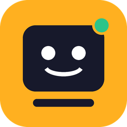

<div align="center">



# Cubicle

**Your personal AI staff. Set them up once — they get your work done, every day.**

[](https://github.com/Pro-Sifat-Hasan/cubicle/actions/workflows/ci.yml)
[](https://github.com/Pro-Sifat-Hasan/cubicle/actions/workflows/security.yml)
[](LICENSE)


</div>

Cubicle is a free, open-source desktop app that gives you a small team of AI employees.
You describe what you need. Your **main agent** plans the work, hands each part to the right
teammate and returns one finished result, with any files they produced saved for you. You decide
who is on the team, how each agent works and which tools, apps and skills it can use, and you can
chat with any of them in the Inbox.

Set up **automations** such as "every weekday at 9:00, plan my day", and your staff do that work in
the background, even when the window is closed.

## Highlights

- **A real team, not one chatbot.** Work is planned, split across specialists, reviewed and merged into one deliverable.
- **Your agents, your way.** Add agents from 18 role templates in one click or build your own: instructions, model, tools, team.
- **Chat with your staff.** Talk to any agent in the Inbox and watch the reply stream in. Agents ask teammates for help when it is useful.
- **MCP, skills and plugins.** Connect agents to GitHub, your files, a browser and more through MCP; teach them with SKILL.md skills; install bundles, including Claude Code plugins.
- **Automations.** Recurring or one-off work for the whole team or one agent: daily, weekdays, chosen days, every few minutes, or once. If your PC was asleep, a missed run happens once when it wakes.
- **Bring any AI.** Use Claude, OpenAI, Google Gemini, OpenRouter, a local model through Ollama, or **your existing Claude subscription** through Claude Code.
- **Tools.** Your staff can search and read the web, save documents and code as files, and remember what they learn about you.
- **Memory.** Preferences, people and projects carry over from task to task. You can see and edit everything they remember.
- **Asks only when needed.** If someone is genuinely blocked, the question lands in your Inbox. Answer it and the work continues.
- **Private by default.** Everything runs on your PC. Keys are encrypted with Windows DPAPI and the service listens only on this machine.
- **Spending guard.** Set a daily token budget, and work pauses when it is reached.

## Install

1. Download **`Cubicle-Setup-<version>.exe`** from the [latest release](https://github.com/Pro-Sifat-Hasan/cubicle/releases/latest).
2. Run it. It installs for your user account in seconds, with no administrator prompt.
3. Cubicle opens in the tray and starts in **demo mode**, so you can try it with no account.

## Get started

1. **Connect an AI.** Open **Settings → AI provider**, pick a provider, paste its API key (or choose
   *Claude Code* to use your subscription), click **Test connection**, pick a model and **Save**.
2. **Give an assignment.** On **Today**, describe the outcome you want, for example
   *"Compare the three best budget laptops for programming and draft a short recommendation"*,
   then click **Assign**.
3. **Watch it happen.** The plan, each employee's progress and the final result appear live.
   Use **Open files** to see any documents they saved.
4. **Shape your team.** Under **Agents**, add roles from templates, edit instructions, and choose
   tools, MCP servers (from **Tools & skills**), skills and teammates. Chat with any agent in the **Inbox**.
5. **Automate it.** Under **Automations**, add standing orders such as *"Every weekday at 08:30:
   summarise the tech news I care about"*.
6. **Teach your staff.** Under **Memory**, add facts like *"I write in British English"*. They also
   learn on their own while they work.

Closing the window keeps your staff working in the background. To stop everything, right-click
the tray icon and choose **Stop staff and quit**.

## Supported AI providers

| Provider | What you need |
|---|---|
| Anthropic Claude API | An API key from [console.anthropic.com](https://console.anthropic.com) |
| Claude Code (your subscription) | [Claude Code](https://claude.com/claude-code) installed and signed in on this PC |
| OpenAI | An API key from [platform.openai.com](https://platform.openai.com) |
| Google Gemini | An API key from [Google AI Studio](https://aistudio.google.com) |
| OpenRouter | An API key from [openrouter.ai](https://openrouter.ai) |
| Ollama (local, free) | [Ollama](https://ollama.com) running with a model pulled |
| Any OpenAI-compatible server | Its URL, and a key if it needs one |

Use of each provider is subject to that provider's terms.

## Run on a server

Cubicle can also run around the clock on a server with Docker:

```bash
docker compose -f deploy/docker/compose.yml up -d
```

See [docs/CONFIGURATION.md](docs/CONFIGURATION.md) for server, Windows service and systemd setups.

## Documentation

- [How it works](docs/ARCHITECTURE.md)
- [Configuration](docs/CONFIGURATION.md)
- [HTTP API](docs/API.md)
- [Security](SECURITY.md)
- [Contributing](CONTRIBUTING.md)

## License

[MIT](LICENSE). Free for personal and commercial use.
