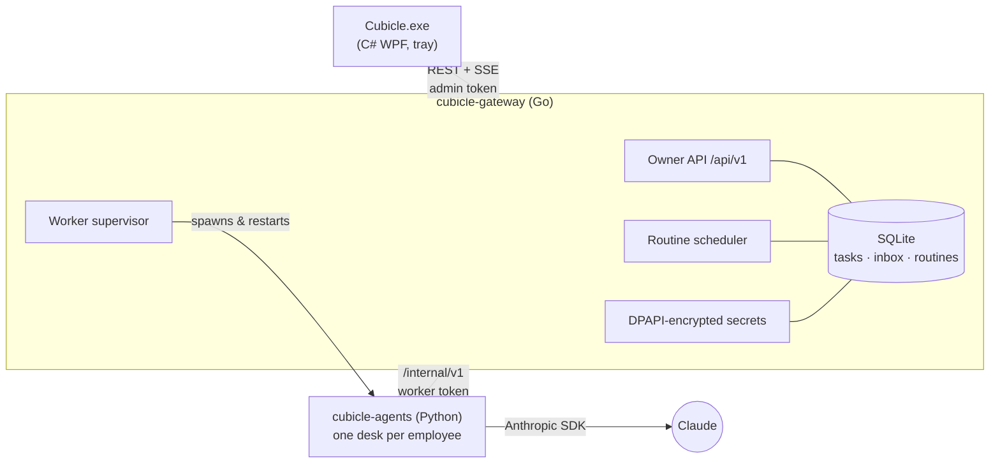

<div align="center">


# Cubicle

### Your personal AI staff. Set them up once — they get your work done, every day.

[](https://github.com/Pro-Sifat-Hasan/cubicle/actions/workflows/ci.yml)
[](LICENSE)


</div>

---

Cubicle gives **you** a small team of AI employees that lives on your own PC. Tell your
**Chief of Staff** what you need. They plan it, hand the pieces to the right specialists,
and bring you back one finished result. Add **routines** ("every weekday at 9:00, plan my
day") and your staff keep doing your recurring work in the background, even when the
window is closed.

```
 You ──► "Draft replies to this week's client emails"
          │
          ▼
   🧭 Max, Chief of Staff ── plans & delegates
          ├──► 🔎 Rhea, Research Analyst ── pulls the facts together
          ├──► ✍️ Quill, Writer ─────────── drafts the replies   (uses Rhea's result)
          └──► ✅ Vera, Reviewer ────────── checks tone & mistakes
          │
          ▼
   🧭 Max wraps up ──► one polished deliverable in your Today view
```

## ✨ Why Cubicle

| | |
|---|---|
| 🗓️ **Routines** | Standing orders on a schedule: daily, weekdays, or every N minutes. Missed runs (PC asleep) collapse into one catch-up run instead of a burst. |
| 🧭 **A real team, not one chatbot** | A manager plans, specialists work in parallel and hand results to each other, and the manager merges everything into one answer. |
| ✉️ **An inbox that only holds what needs you** | Employees ask you a question only when they are truly blocked. Answer it and the work resumes automatically. |
| 🌙 **Runs in the background** | Lives in the tray, starts when you sign in, keeps working when the window is closed. Crashed workers restart on their own. |
| 🔒 **Private and secure by default** | Everything runs on your PC. API keys are encrypted with Windows DPAPI, the API listens on localhost only, and every request needs a token. [Security model →](SECURITY.md) |
| 🧯 **Spend circuit breaker** | Set a daily token budget. When it's reached, work pauses until you resume it or the next day starts. |
| 🧪 **Try it without a key** | A built-in demo provider runs the whole office offline, so you can see it work before adding an Anthropic API key. |
| 🖥️ **Desktop and server** | Windows installer for your PC, a Windows service, or Docker / systemd for an always-on server. |

## 🚀 Install (Windows)

1. Download **`Cubicle-Setup-x.y.z.exe`** from [Releases](https://github.com/Pro-Sifat-Hasan/cubicle/releases).
2. Run it. It installs per-user, with no admin prompt, in a few seconds.
3. Cubicle opens in demo mode. Go to **Settings → Anthropic API key** to put your staff to real work.

> Your office data lives in `%LOCALAPPDATA%\Cubicle`. The uninstaller asks before deleting it.

## 🧱 Architecture

Each part uses the language that fits it best:

| Component | Language | Why | Folder |
|---|---|---|---|
| **Desktop app**: tray, dashboard, inbox, routines | **C# / .NET 10 (WPF)** | Native, modern Windows UI (Fluent theme) that ships as a single self-contained `.exe` | [`desktop/`](desktop) |
| **Gateway**: API, state, scheduler, supervisor, security | **Go** | One static binary with no runtime, fast, ideal for an always-on service | [`gateway/`](gateway) |
| **Agents**: the AI staff | **Python** | The richest AI ecosystem and the official Anthropic SDK | [`agents/`](agents) |
| **Installer** | **Inno Setup** | Small, fast per-user installs with clean upgrades and uninstalls | [`installer/`](installer) |



The full design is in [docs/ARCHITECTURE.md](docs/ARCHITECTURE.md), and the HTTP API is in [docs/API.md](docs/API.md).

## 🗂️ Repository layout

```
cubicle/
├── gateway/            Go control plane
│   ├── cmd/cubicle-gateway/     entry point (serve | service install …)
│   ├── internal/                api · store · secrets · supervisor · events · config · winsvc
│   └── test/                    black-box API + store tests
├── agents/             Python AI staff
│   ├── src/cubicle_agents/      core · llm · staff · office
│   └── tests/                   pytest suite (no network needed)
├── desktop/            C# Windows app
│   ├── src/Cubicle.Client/      typed API client (UI-free, unit-tested)
│   ├── src/Cubicle.Desktop/     WPF app: Views · ViewModels · Services · Themes
│   └── tests/Cubicle.Client.Tests/
├── installer/          Inno Setup script
├── deploy/             docker/ (Dockerfile, compose) · systemd/
├── scripts/            build · dev · test · smoke-test · brand/
├── docs/               architecture · API · branding
└── assets/brand/       logo and icons
```

## 🛠️ Build from source

Prerequisites: [Go 1.26+](https://go.dev/dl/), [uv](https://docs.astral.sh/uv/), [.NET 10 SDK](https://dotnet.microsoft.com/download), and optionally [Inno Setup 6](https://jrsoftware.org/isinfo.php) for the installer.

```powershell
git clone https://github.com/Pro-Sifat-Hasan/cubicle.git
cd cubicle
./scripts/dev.ps1          # run gateway + agents + desktop from source
./scripts/test.ps1         # every test suite and linter (same as CI)
./scripts/smoke-test.ps1   # end-to-end: real gateway + real worker
./scripts/build.ps1        # dist/Cubicle-Setup-<version>.exe
```

## 🖧 Run on a server

```bash
docker compose -f deploy/docker/compose.yml up -d --build
docker compose -f deploy/docker/compose.yml exec cubicle cat /data/admin.token
```

You can also run it as a Windows service (`cubicle-gateway service install`, as Administrator) or use
the hardened [systemd unit](deploy/systemd/cubicle.service). To reach it remotely, put it behind TLS;
the gateway refuses non-loopback addresses without TLS unless you explicitly opt in.

## 👥 Customise your staff

```powershell
cubicle-agents init-staff   # writes %LOCALAPPDATA%\Cubicle\staff.json
```

Edit names, titles, skills, personas, and the model per employee, then restart Cubicle. There must
be exactly one employee with `"role": "manager"`.

## 🗺️ Roadmap

- [x] Manager → specialists → wrap-up workflow, inbox, routines, circuit breaker
- [x] Windows app with tray, auto-start, installer, Windows service, Docker
- [ ] Tools: web search, files in a sandboxed workspace, email and calendar connectors (MCP)
- [ ] Long-term memory per employee
- [ ] Phone companion app to answer the inbox on the go
- [ ] More providers and local models

## 🤝 Contributing

PRs are welcome. Start with [CONTRIBUTING.md](CONTRIBUTING.md). Development happens on `develop`;
`main` always holds the latest release.

## 📄 License

[MIT](LICENSE). Free for personal and commercial use.
