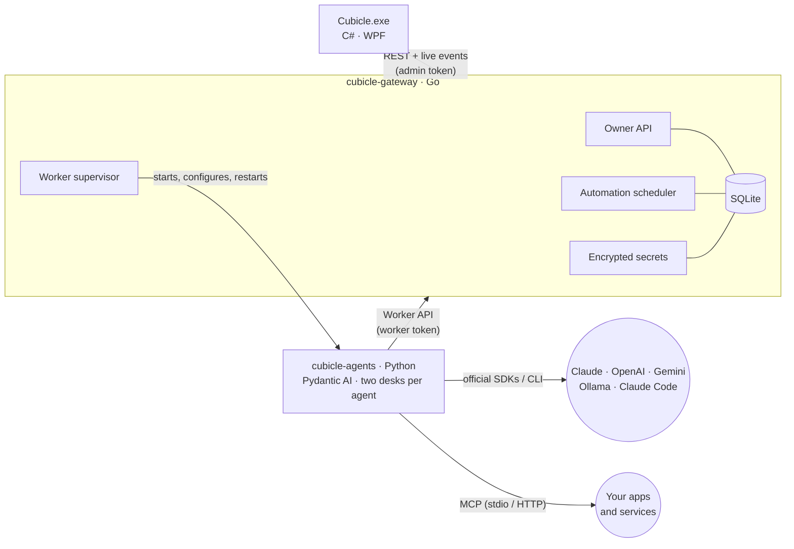

# Architecture

Cubicle runs as three cooperating processes on your machine.



| Process | Responsibility |
|---|---|
| **Desktop app** | What you see: tray icon, Today, Inbox (chat), Agents, Automations, Tools & skills, Memory, Activity and Settings. Holds no state of its own. |
| **Gateway** | The single source of truth. It stores agents, MCP servers, skills, plugins, conversations and work in SQLite, serves the owner and worker APIs, fires automations, enforces the token budget, encrypts secrets, and starts and restarts the agent worker. |
| **Agents** | The AI staff, built on [Pydantic AI](https://ai.pydantic.dev). Every agent works at two *desks*: one for tasks and one for chats, so a long task never blocks a reply. It claims work, does it with its model, tools, MCP servers and skills, and reports the result. |

## Agents

You manage agents in the app; the gateway stores them and the worker follows changes within moments
(it long-polls a revision counter), so editing an agent never interrupts work in progress.

| Setting | Effect |
|---|---|
| Instructions | The agent's system prompt: how it thinks and works |
| Good at | A short description; the main agent picks teammates by it |
| Model, effort | Override the office defaults from Settings |
| Tools | Built-in tools: files, web, memory, and (from chats) starting assignments |
| MCP servers | External tools the agent may use |
| Skills | Instructions the agent loads when a task matches (SKILL.md format) |
| Team | Agents it can hand work to or consult |

Exactly one agent is the **main agent**. It receives assignments and automations, plans them with
its team, and writes the final result. A new office starts with Max (main) and five specialists;
the Agents page adds more from 18 role templates in one click.

## How an assignment is done

```
assignment (you → main agent)
 ├── subtask → teammate        ┐ run in parallel unless one depends on another
 ├── subtask → teammate        ┘
 ├── review  → reviewer        (for documents, emails or code you will rely on)
 └── wrap-up → main agent      (runs once every subtask is done)
```

1. **Plan.** The main agent turns your request into a plan. Pydantic AI validates it against a
   JSON schema and asks the model to fix invalid answers. The worker keeps only real team members and
   valid dependencies, and the gateway checks again before creating the subtasks and the wrap-up in
   one transaction. A main agent without a team does the work itself.
2. **Work.** A teammate claims a subtask once its dependencies are finished. The claim includes
   the overall assignment, teammates' results and any answers you gave. The teammate works in a
   tool loop with its own instructions, tools, MCP servers and skills, and may consult its own teammates.
3. **Ask.** If an agent is blocked, it asks you through the Inbox. The task pauses and
   resumes automatically when you answer. Each task can ask at most twice.
4. **Wrap up.** The main agent merges the results into one deliverable, references the files that
   were produced, and lists anything that needs you. Completing the wrap-up completes the assignment.

You can also give an assignment straight to one agent, which then does it alone.

A failed subtask fails its assignment and cancels the remaining work, so nothing waits forever.

## Onboarding, passions and professions

First run walks the owner through five screens: name the chief of staff, pick a profession, pick a
passion (or type their own), watch the team get hired, and start a first mission.

- A **profession** pack decides the team (extra specialists), their routines and the starter
  missions. Hired teammates join the main agent's team; routines marked `enabled` are switched on,
  the rest wait in Automations.
- A **passion** pack decides the main agent's voice (`system_prompt_style`, appended to its
  instructions), the greetings on Today, the daily feed queries and the accent colour the app uses.
  Only the main agent takes the voice; specialists stay professional.
- A **custom** passion is written by the main agent: the gateway queues a hidden `persona` task, the
  worker answers with schema-validated JSON, and the gateway clamps it before anything is stored.
  With no model available a plain persona is used instead, so setup never blocks.
- The owner's profession and stack are saved as memories, so every agent sees them.

Packs are JSON in `gateway/internal/catalog/packs/`; adding one needs no code.

## Chat

Each message you send in the Inbox becomes a chat task for that agent, with the conversation so far.
While it works, the agent streams progress ("Searching the web…") and the reply as it is written.
In a chat an agent can consult teammates (`ask_teammate`: the teammate runs with its own
configuration and returns its answer) and, with the *assignments* tool, start a full assignment for
the team.

## Providers

The gateway turns the provider you choose in Settings into environment variables for the worker,
and restarts the worker whenever settings or keys change.

| Adapter | Used for | How it works |
|---|---|---|
| Pydantic AI | Claude API, OpenAI, Gemini, OpenRouter, Ollama, custom servers | One engine: tool loop, validated structured output with retries, streaming, usage limits. Claude gets adaptive thinking, effort control, prompt caching and server-side web search and fetch; OpenAI gets native web search; other servers get DuckDuckGo search and Cubicle's guarded fetch |
| Claude Code | Your Claude subscription | Runs your installed `claude` CLI headlessly in the work folder, with file and web tools only (no shell). MCP servers are passed with `--mcp-config` |
| Demo | Trying Cubicle out | Sample answers with no model |

**Test connection** in Settings runs `cubicle-agents models`, which asks the provider for its model
list. A successful list confirms the key works.

## Tools

| Tool | Purpose | Safeguards |
|---|---|---|
| `write_file`, `read_file`, `list_files` | Produce deliverables in `workspace/<assignment or chat>/` | Paths are confined to that folder, with size and file-count limits |
| web search and fetch | Check facts and read pages | Cubicle's own fetch allows only public http(s) addresses, re-checks every redirect, and limits size |
| `remember` | Save a durable fact about you to office memory | Length limit, de-duplication, and a cap of 300 facts |
| `load_skill` | Load a skill's full instructions | Only the agent's own skills |
| `ask_teammate` | Consult a teammate | Only the agent's team; a consulted teammate cannot consult further |
| `start_assignment` | Start a team assignment from a chat | Only in chats, only with the *assignments* tool |
| `ask_owner` | Ask you a question through the Inbox | Ends the turn, and is limited per task |

Providers that cannot run Cubicle's tools (Claude Code, Demo) use plain-text directives instead.
A line starting with `REMEMBER:` saves a fact, and `ASK_OWNER:` asks a question. Their skills are
included in full in the prompt.

## MCP servers, skills and plugins

- **MCP servers** run (stdio) or are reached (HTTP) only for the run that needs them. A stdio server
  gets a minimal environment plus the variables and secrets configured for it, never every secret the
  worker holds. A server that fails to start is skipped with a warning in the Activity log, and the
  work goes on. Its own output goes to `<home>/logs/mcp-<id>.log`. **Test** on the Tools page starts
  the server through the worker and lists its tools.
- **Skills** use the `SKILL.md` format: a name, a description that says when to use it, and
  instructions. Agents see the descriptions and load a skill when a task matches.
- **Plugins** install agents, MCP servers and skills together, and uninstall them together. Built-in
  packs are available, and Claude Code plugin folders (`.claude-plugin/plugin.json`, `agents/`,
  `skills/`, `.mcp.json`) can be imported. `${NAME}` values become references to Cubicle secrets.

## Automations and the budget

Automations (`daily@HH:MM`, `weekdays@HH:MM`, `weekly@mon,thu@HH:MM`, `every:30m` with a 5-minute
minimum, or `once@YYYY-MM-DDTHH:MM`) become assignments for the main agent, or for the agent you
chose. Runs missed while the PC was off collapse into a single run. **Run now** starts one
immediately without changing the schedule.

Every model call reports its token usage. When the daily budget is reached, the circuit breaker
opens: new work pauses until midnight or until you click **Resume work**.

## Reliability

- Task claims are 25-second long-polls inside a single SQLite transaction. Any change wakes the waiting desks instantly.
- SQLite runs in WAL mode with one connection, which serialises writes. New columns are added on start, so older databases upgrade in place.
- A crashed worker restarts with exponential backoff, and work it was doing is queued again when the new worker starts. The Windows service restarts on failure.
- The desktop app reconnects automatically and refreshes from the live event stream.
