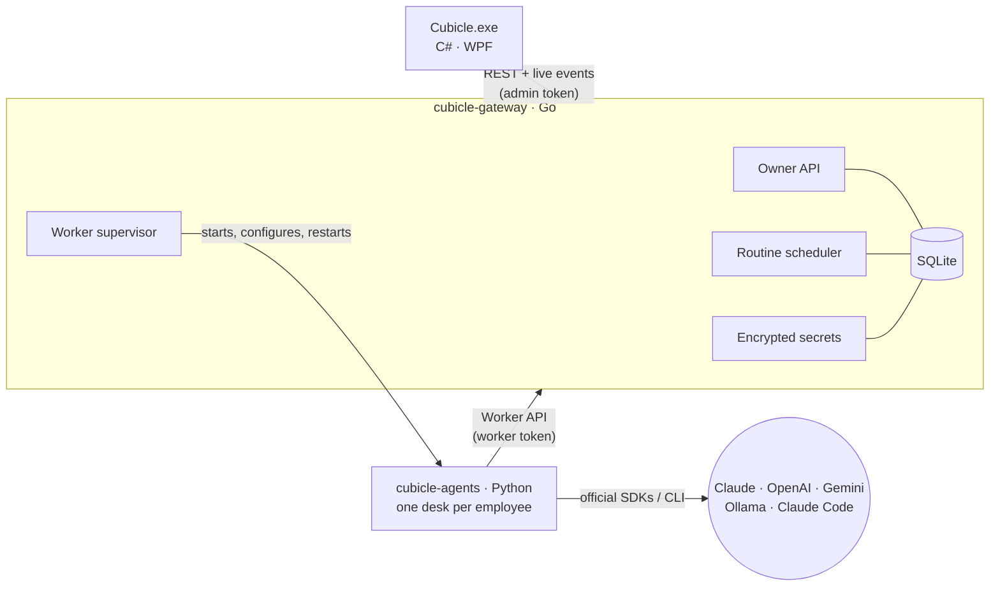

# Architecture

Cubicle runs as three cooperating processes on your machine.



| Process | Responsibility |
|---|---|
| **Desktop app** | What you see: tray icon, Today, Inbox, Routines, Memory, Activity and Settings. Holds no state of its own. |
| **Gateway** | The single source of truth. It stores everything in SQLite, serves the owner and worker APIs, fires routines, enforces the token budget, encrypts secrets, and starts and restarts the agent worker. |
| **Agents** | The AI staff. Each employee works at its own *desk*: it claims a task, works on it with a model and tools, and reports the result. |

## How an assignment is done

```
assignment (you → Chief of Staff)
 ├── subtask → specialist        ┐ run in parallel unless one depends on another
 ├── subtask → specialist        ┘
 ├── review  → Quality Reviewer  (for documents, emails or code you will rely on)
 └── wrap-up → Chief of Staff    (runs once every subtask is done)
```

1. **Plan.** The manager turns your request into a JSON plan (structured output). The gateway
   validates it: assignees must exist, and dependencies may only point to earlier subtasks.
   It then creates the subtasks and a wrap-up task in one transaction.
2. **Work.** A specialist claims a subtask once its dependencies are finished. The claim includes
   the overall assignment, teammates' results and any answers you gave. The specialist works in
   a loop with tools until the job is done.
3. **Ask.** If a specialist is blocked, it asks you through the Inbox. The task pauses and
   resumes automatically when you answer. Each task can ask at most twice.
4. **Wrap up.** The manager merges the results into one deliverable, references the files that
   were produced, and lists anything that needs you. Completing the wrap-up completes the assignment.

A failed subtask fails its assignment and cancels the remaining work, so nothing waits forever.

## Providers

The gateway turns the provider you choose in Settings into environment variables for the worker,
and restarts the worker whenever settings or keys change.

| Adapter | Used for | How it works |
|---|---|---|
| Anthropic | Claude API | Official Anthropic SDK with adaptive thinking, effort control, server-side web search and fetch, and refusal fallback |
| OpenAI-compatible | OpenAI, Gemini, OpenRouter, Ollama, custom servers | Official OpenAI SDK, function calling, and structured output when the server supports it |
| Claude Code | Your Claude subscription | Runs your installed `claude` CLI headlessly in the assignment folder, with file and web tools only (no shell) |
| Demo | Trying Cubicle out | Sample answers with no model |

**Test connection** in Settings runs `cubicle-agents models`, which asks the provider for its model
list. A successful list confirms the key works.

## Tools

| Tool | Purpose | Safeguards |
|---|---|---|
| `write_file`, `read_file`, `list_files` | Produce deliverables in `workspace/<assignment>/` | Paths are confined to the assignment folder, with size and file-count limits |
| `web_fetch` | Read public web pages (for providers without a built-in web tool) | Only public http(s) addresses, every redirect re-checked, and a size limit |
| `remember` | Save a durable fact about you to office memory | Length limit, de-duplication, and a cap of 300 facts |
| `ask_owner` | Ask you a question through the Inbox | Ends the turn, and is limited per task |

Providers that cannot run Cubicle's tools (Claude Code, Demo) use plain-text directives instead.
A line starting with `REMEMBER:` saves a fact, and `ASK_OWNER:` asks a question.

## Routines and the budget

Routines (`daily@HH:MM`, `weekdays@HH:MM`, or `every:30m` with a 5-minute minimum) become
assignments for the manager. Runs missed while the PC was off collapse into a single run.

Every model call reports its token usage. When the daily budget is reached, the circuit breaker
opens: new work pauses until midnight or until you click **Resume work**.

## Reliability

- Task claims are 25-second long-polls inside a single SQLite transaction. Any change wakes the waiting desks instantly.
- SQLite runs in WAL mode with one connection, which serialises writes.
- A crashed worker restarts with exponential backoff. The Windows service restarts on failure.
- The desktop app reconnects automatically and refreshes from the live event stream.
